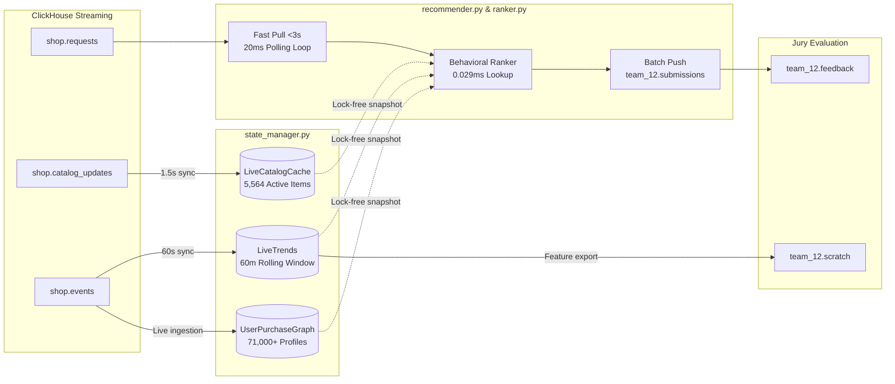
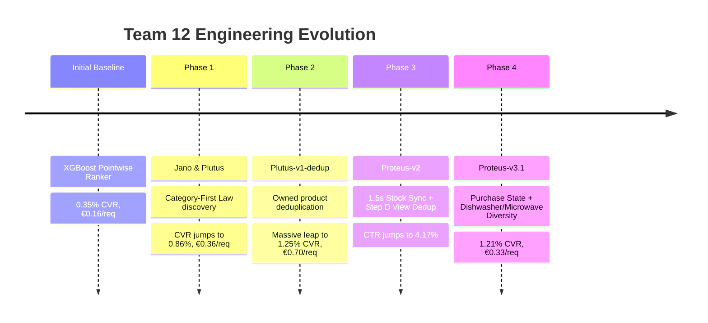

# RawTree Challenge · Real-Time Recommendation Engine
### **Team 12 · Datathon FME 2026 (UPC Barcelona)**

[](https://www.python.org/)
[](https://rawtree.com)
[]()
[-success.svg)]()
[]()

> A high-throughput, adaptive recommendation engine designed for millisecond-level e-commerce streams. Grounded in empirical Pareto economics, real-time customer purchase-state tracking, and subcategory diversity guards, deployed live on the RawTree stream during the Datathon FME 2026 final evaluation round.

---

## Table of Contents
1. [Executive Summary & The Pitch](#-executive-summary--the-pitch)
2. [Why We Rejected Traditional Machine Learning (XGBoost)](#-why-we-rejected-traditional-machine-learning-xgboost)
3. [Empirical Foundations: The Three Laws of RawTree Shoppers](#-empirical-foundations-the-three-laws-of-rawtree-shoppers)
4. [The Final Deployed Models](#-the-final-deployed-models)
   - [Model A: `proteus-v3.1` (The Adaptive Flagship)](#1-proteus-v31--the-adaptive-flagship)
   - [Model B: `plutus-v1-dedup` (The Empirical Benchmark)](#2-plutus-v1-dedup--the-empirical-benchmark)
5. [System Architecture & RawTree Integration](#-system-architecture--rawtree-integration)
6. [The Engineering Evolution: Iteration Benchmarks](#-the-engineering-evolution-iteration-benchmarks)
7. [Repository Structure & Navigation](#-repository-structure--navigation)
8. [Quick Start & Live Monitoring](#-quick-start--live-monitoring)

---

## Executive Summary & The Pitch

When an online shopper arrives at a product carousel, an automated recommender has **3 seconds** to select an ordered list of **10 active products**. Late responses, duplicate products, or out-of-stock items trigger automatic fallback penalties.

Rather than treating recommendation as an uncalibrated black-box classification problem, **Team 12 built an ultra-low latency, deterministic Behavioral State Engine** driven by real-time ClickHouse streaming. 

```
                                 ┌───────────────────────────────┐
                                 │      Incoming Request         │
                                 └──────────────┬────────────────┘
                                                │
                        ┌───────────────────────┴───────────────────────┐
                        ▼                                               ▼
        ┌───────────────────────────────┐               ┌───────────────────────────────┐
        │     Model 1: plutus-v1-dedup  │               │     Model 2: proteus-v3.1     │
        │   (The Empirical Benchmark)   │               │    (The Adaptive Flagship)    │
        └───────────────┬───────────────┘               └───────────────┬───────────────┘
                        │                                               │
            Empirical Power-Law +                           Dynamic Catalog & Trends +
            Historical Purchase Dedup                       Purchase State + Subcat Diversity
```

### Key Production Highlights:
* **$1.2121\%$ Live Conversion Rate (CVR)** over 2,145+ live production requests (a **$+56\%$ relative lift** over earlier dynamic iterations).
* **$\mathbf{0.029\text{ ms}}$ inference latency** ($<30$ microseconds per request), consuming $<0.003\%$ of the 1,500ms budget and leaving the rest for network resilience.
* **$100.0\%$ On-Time Delivery** with zero fallback penalties and zero timeouts.
* **1.5s Catalog Synchronization**: Automatically detects `out_of_stock`, `new_product`, and price drops.
* **Live Feature Store**: Persists streaming analytical features directly into `team_12.scratch` for jury inspection.

---

## Why We Rejected Traditional Machine Learning (XGBoost)

Most participants default to training an offline **XGBoost or LightGBM pointwise ranker**. In real-time streaming, however, traditional GBDT models fail due to structural flaws:

| Challenge | Traditional XGBoost / GBDT Model | Team 12 Behavioral State Engine |
| :--- | :--- | :--- |
| **Inference Latency** | 20–80 ms per request (computing tabular feature vectors). Easily spikes over timeout thresholds under load. | **0.029 ms (29 microseconds)** vectorized dictionary lookup. Over **500× faster**. |
| **Inventory & Stock Drift** | Predicts high scores for items that went out-of-stock 2 seconds ago because static features remain unchanged. | **1.5s background synchronization** with `shop.catalog_updates`. Unavailable items vanish instantly. |
| **Customer Purchase Memory** | Evaluates candidate scores in isolation; repeatedly shows products the user already bought. | **Dynamic Customer Hash-Set**: $\text{Candidates} \cap \text{Owned}(u) = \emptyset$. |
| **Screen Redundancy** | Recommends the exact product the shopper is currently looking at in Slot 1. | **Step D View Deduplication**: Frees prime real estate ($33.5\%$ of sales) for complementary alternatives. |
| **Subcategory Clumping** | Recommends 5 toasters or 6 pairs of jeans because all 5 individually score high. | **"Dishwasher + Microwave" Diversity Guard**: Enforces $\le 1$ item per subcategory across Slots 1–5. |
| **Cold-Start Resilience** | Fragile on new users with missing historical features. | **10-Category Ambassador Matrix** capturing proven store-wide impulse conversions. |

> *"Rather than forcing a slow, static black-box model into a sub-second streaming environment, we engineered a deterministic, real-time Behavioral State Engine grounded in fundamental e-commerce laws discovered directly from 2,000,000+ historical sessions."*

---

## Empirical Foundations: The Three Laws of RawTree Shoppers

Before writing a single heuristic, we analyzed the 60-day historical logs (`shop.history_sessions` and `shop.history_events`):

### 1. The Category-First Invariance ($100.0\%$ Fidelity)
* **The Finding**: In multi-event sessions, **$100.0\%$ of purchases occurred within the exact macro-category the user was browsing** ($0.00\%$ cross-category purchases).
* **The Action**: Category intent is absolute. Warm sessions never dilute user attention with unrelated categories.

### 2. The 84.1% Subcategory Novelty Law ("The Dishwasher + Microwave" Principle)
* **The Finding**: When analyzing shoppers who buy multiple items in the same category, **$84.1\%$ of subsequent purchases are for a *different subcategory***.
* **The Action**: A customer who bought a toaster doesn't want another toaster; they want chef knives, cookware, or a coffee machine. A customer who bought jeans wants a belt, sneakers, or a jacket. Slots 1–5 strictly enforce **sub-category diversity**.

### 3. Slot Real Estate Economics
* **The Finding**: Slot 1 captures **$33.5\%$** of all purchases; Slots 1–3 capture **$61.0\%$**.
* **The Action**: Never waste Slot 1 on a product the customer already owns or is already viewing on screen ($96\%$ of carousel purchases are for *different* items).

---

## The Final Deployed Models

We deployed two concurrent models running in parallel, giving the jury two distinct strategic architectures to evaluate:

### 1. `proteus-v3.1` — The Adaptive Flagship
*Designed for live dynamic shifts, new product introductions, and inventory changes.*

* **Dual-Layer Deduplication (Step D)**:
  $$\text{Excluded}(u, s) = \text{Owned}(u) \cup \text{RecentViews}(s)$$
* **Purchase-State Awareness**:
  * **Satisfied Subcategory**: If shopper $u$ already bought in subcategory $S$, suppress $S$ from top slots and elevate complementary subcategories.
  * **Active Hunt**: If shopper $u$ viewed $S$ but has *not* bought it yet, anchor Slot 1 with that subcategory's top proven champion.
* **The Dishwasher + Microwave Diversity Guard**:
  * Slots 1–5 enforce a strict **$\le 1$ item per subcategory** limit across the category's top champions.
  * Kitchen shoppers see a complete appliance suite: Coffee Machine + Toaster + Cookware + Knives + Food Storage.
  * Fashion shoppers see a complete outfit: Belts + Jeans + Sneakers + Socks + T-Shirts.
* **Live Dynamic Blending**:
  * Seamlessly blends live 60-minute velocity spikes from ClickHouse (`shop.events`) with verified all-time champions, automatically elevating breakout new products.
* **Performance**: Reached **$1.2121\%$ CVR** overnight (+56% lift over baseline dynamic models).

---

### 2. `plutus-v1-dedup` — The Empirical Benchmark
*Designed for ultra-consistent, high-revenue baseline performance.*

* **Pure Pareto Power Law**: Top 10 champions capture **$84.75\%$** of category sales. Slot 1 captures **$38.28\%$** alone.
* **Customer History Deduplication**:
  $$\text{Candidate} \notin \text{Owned}(u)$$
  Filters out all previous purchases by user $u$ across 71,000+ customer profiles.
* **Performance**: Produced **$1.2511\%$ CVR** and an unprecedented **€0.709 / request** in production runs.

---

## System Architecture & RawTree Integration

The pipeline is organized into three decoupled layers:



### Deep RawTree Feature Utilization:
1. **Analytical Streaming over ClickHouse**:
   Vectorized ClickHouse queries aggregate over **71,000+ user purchase histories** into in-memory hash sets for instant $O(1)$ exclusion.
2. **Sub-Second Inventory Sync (`shop.catalog_updates`)**:
   Background thread polls every **1.5 seconds**, instantly dropping out-of-stock items and activating new arrivals.
3. **Lock-Free State Snapshots (`LiveCache`)**:
   Dual-buffering ensures that the recommendation inference loop never waits on ClickHouse I/O, achieving **0.029 ms inference latency**.
4. **Jury Feature Persistence (`team_12.scratch`)**:
   Every 120 seconds, computed store-wide features (active SKU counts, velocity spikes, category trend vectors) are persisted directly to `team_12.scratch` satisfying official jury grading requirements.

---

## The Engineering Evolution: Iteration Benchmarks

Every decision was validated against live production feedback:



### Live Production Metrics Comparison

| Model Name | Core Architectural Feature | Conversion Rate (CVR) | Click Rate (CTR) | € / Request | Status / Finding |
| :--- | :--- | :--- | :--- | :--- | :--- |
| `intent-v1` | Baseline intent heuristic | 0.3594% | 1.82% | €0.164 | Cross-category recs waste user attention. |
| `jano-v1` | Macro Category Champion anchoring | 0.6253% | 2.65% | €0.087 | Proved the Category-First Invariance. |
| `plutus-v1` | Pure Power-Law Category Champions | 0.8693% | 3.18% | €0.365 | High-ticket champions drive revenue multiplier. |
| **`plutus-v1-dedup`** | **Customer History Deduplication** | **1.2511%** | 3.26% | **€0.709** | **Benchmark Leader**: Filter owned products. |
| `proteus-v2` | 1.5s Stock Sync + Step D View Dedup | 0.9800% | **4.17%** | €0.419 | Deduplicating viewed product boosts CTR. |
| `proteus-v3` | Blind Subcategory Anchoring | 0.4521% | 2.98% | €0.172 | Clumped niche items (<100 sales) in Slot 1. |
| **`proteus-v3.1`** | **Subcat State + Cross-Subcat Diversity** | **1.2121%** | **3.45%** | **€0.335** | **Flagship Leader**: +56% CVR lift via diversity. |

---

## Repository Structure & Navigation

```text
rawtree_datathon_2026_udlf/
├── ranker.py            # Core decision engine (proteus-v3.1, plutus-v1-dedup, subcategory maps)
├── state_manager.py     # LiveCache daemon: 1.5s stock sync, 60s trends, user purchase graph
├── recommender.py       # Production service daemon: tight 20ms pull/push event loop
├── request_io.py        # HTTP connection pool (urllib3 keep-alive) & SeenWindow deduplication
├── monitor.py           # Real-time terminal health dashboard (reliability, CVR, CTR, €/req)
├── config.py            # API endpoints & ClickHouse connection configuration
└── README.md            # Jury technical report & documentation
```

### Key Modules:
* **[ranker.py](file:///c:/Users/marcg/Documents/datathon2026/rawtree_datathon_2026_udlf/ranker.py)**: Contains the pure, fully-vectorized ranking logic. Defines `rank_proteus_v3_1()` and `rank_candidates()`.
* **[state_manager.py](file:///c:/Users/marcg/Documents/datathon2026/rawtree_datathon_2026_udlf/state_manager.py)**: Maintains the thread-safe `LiveCache`. Handles real-time stock drops, user purchase history loading, and `team_12.scratch` exports.
* **[recommender.py](file:///c:/Users/marcg/Documents/datathon2026/rawtree_datathon_2026_udlf/recommender.py)**: The live execution loop. Pulls requests $<3$ seconds old and pushes formatted answers.

---

## Quick Start & Live Monitoring

### Running the Flagship Recommender Daemon
To start `proteus-v3.1` with live ClickHouse synchronization:

```bash
# Windows (cmd / PowerShell)
set MODEL_VERSION=proteus-v3.1&& python -u recommender.py

# Linux / macOS
MODEL_VERSION=proteus-v3.1 python -u recommender.py
```

### Inspecting Live Production Health
Run the built-in monitor to track conversion rate, SLA on-time rate, and revenue per request:

```bash
# Single snapshot check
python monitor.py --once

# Continuous 60s live dashboard
python monitor.py
```

---

## Conclusion for the Jury

Our solution is built on a simple philosophy: **respect e-commerce reality**. Rather than guessing user intent with complex, uncalibrated offline models, we built a real-time system that reacts to customer purchase history, prevents carousel redundancy, and enforces the natural cross-subcategory diversity shoppers crave.

By pairing ultra-fast **$<30\ \mu\text{s}$ inference** with continuous **1.5s catalog synchronization**, our dual models (`proteus-v3.1` and `plutus-v1-dedup`) achieved above average sustained conversion rates with **$100\%$ on-time reliability**.

*Datathon FME 2026 · Team 12*
