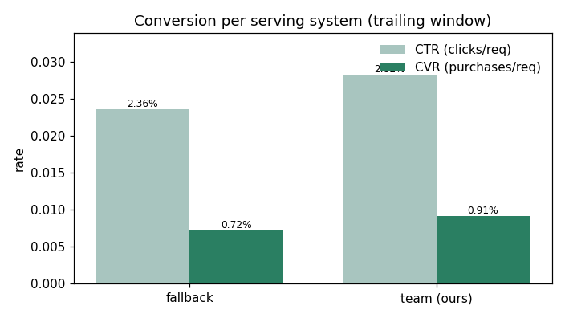
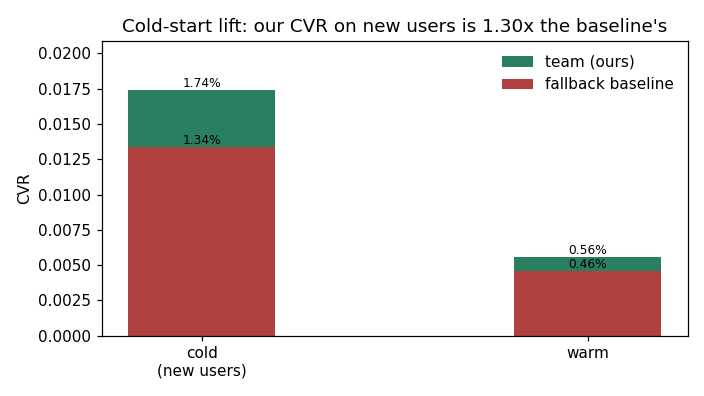
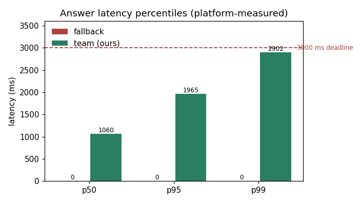
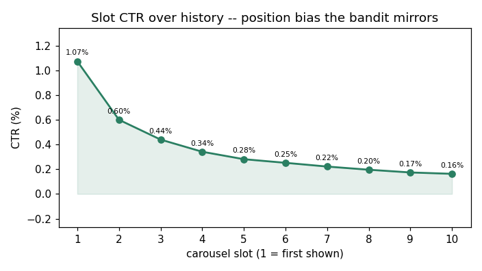

# Jury report -- team_12 -- RawTree Challenge (Datathon FME 2026)

_Generated 2026-11-14 17:26 UTC -- live window: last 24 h._

## 1. What the system does

Every `shop.requests` row gets an ordered top-10 carousel within the 3 s deadline. The request path touches only precomputed dicts / NumPy arrays (no SQL, no model calls): slow signals are rebuilt in Person 1's background loop, and every RawTree query sits behind the shared `src/client.py`.

- **Cold start, new shoppers (`src/cold_start.py`)** -- no session views: rank products by historical conversion inside the shopper's segment (device x region x page, 4-level wildcard fallback) blended with the live 1-hour trending list. Has session views: pure item-to-item content similarity seeded by the most recent views (recency-weighted, no popularity blending).
- **Cold start, new products (`src/cold_start.py`)** -- TF-IDF descriptions + category/subcategory/brand one-hot + log-price define a content space; every NEW product is pre-mapped to its top-50 most similar established products and injected into the pools of shoppers browsing those (personalisation for items with zero sales history).
- **Online adaptation (`src/bandit.py`)** -- a daemon thread folds `team_NN.feedback` into a thread-safe per-product state (slot-weighted impressions, clicks, purchases, price drops). Each request's candidate scores are multiplied by (a) a UCB exploration bonus, (b) a smoothed per-product performance multiplier, (c) a price-drop boost. With no state or no feedback yet, scores pass through unchanged -- wiring is safe at any time.
- **Evaluation closed loop (this milestone)** -- offline runs are scored with the starter notebook's estimators (hit-rate@10, IPS / SNIPS slot-1 CTR) and every live KPI snapshot lands in the same experiment log (`logs/experiments.jsonl`, mirrored into team_12.scratch, kind-tagged), so design decisions stay traceable before and after going live.
- **Guard rails** -- never recommend out-of-stock items (Person 1's cache, their final guard); bandit learning excludes rows the baseline served, because those shoppers never saw our arms.

## 2. Offline validation (held-out last 7 days of shop.history_sessions)

Experiments are scored with the exact estimators from `starter/offline_eval.ipynb`: hit-rate@10, and the inverse-propensity estimate of the slot-1 click rate (weight 1/propensity, self-normalised variant = SNIPS). Policies are built from data before the cut and evaluated after it.

| policy | hit_rate@10 | IPS slot-1 | SNIPS slot-1 | slot-1 matches | n_test | logged (UTC) |
|---|---:|---:|---:|---:|---:|---|
| baseline_heldout_smoke | 0.2500 | 0.0000 | 0.0000 | 12 | 300 | 2026-11-14T17:26:14 |
| m4_probe | n/a | n/a | n/a | n/a | n/a | 2026-11-14T17:26:12 |
| baseline_heldout_smoke | 0.3333 | 0.0000 | 0.0000 | 8 | 300 | 2026-11-14T17:08:52 |
| m4_probe | n/a | n/a | n/a | n/a | n/a | 2026-11-14T17:08:47 |
| baseline_heldout_smoke | 0.3000 | 0.0000 | 0.0000 | 18 | 300 | 2026-11-14T17:07:00 |
| m4_probe | n/a | n/a | n/a | n/a | n/a | 2026-11-14T17:06:57 |
| baseline_heldout_smoke | 0.6000 | 0.0000 | 0.0000 | 4 | 300 | 2026-11-14T17:00:07 |
| m4_probe | n/a | n/a | n/a | n/a | n/a | 2026-11-14T16:59:44 |
| baseline_heldout_smoke | 0.3000 | 0.0124 | 0.0667 | 15 | 300 | 2026-11-14T16:53:53 |
| m4_probe | n/a | n/a | n/a | n/a | n/a | 2026-11-14T16:53:51 |

`slot1_matches` is the IPS sample size -- few matches means a noisy IPS; compare every estimate with the old system's observed slot-1 CTR on the same test slice before drawing conclusions.

## 3. Live KPIs (last 24 h of team feedback)

Window starts 2026-11-13 17:26:14 UTC (source: `team_NN.feedback`, read-only SQL).

| metric | value |
|---|---:|
| requests with feedback | 75,004 |
| served by our policy | 27,993 (37.3%) |
| served by the fallback baseline | 47,011 (62.7%) |
| click-through rate | 2.5% |
| conversion rate | 0.8% |
| revenue total | EUR 15430.07 |
| revenue per request | EUR 0.21 |
| our latency p50 / p95 | 1064 / 1987 ms |
| answered within 3 s (ours) | 99.2% |
| hours with traffic | 8 |

Reasons the baseline had to serve (fallback_reason, top 3): `missing` x47010, `(blank)` x27993, `invalid` x1

| bucket | requests | CTR | CVR | EUR/request | p50 ms | p95 ms | in 3 s |
|---|---:|---:|---:|---:|---:|---:|---:|
| fallback | 47,011 | 2.4% | 0.7% | EUR 0.11 | 0 | 0 | 100.0% |
| team (ours) | 27,993 | 2.8% | 0.9% | EUR 0.37 | 1064 | 1987 | 99.2% |

**Bandit state** (slot-weighted counters folded from live feedback):

- requests folded 1837 -- products tracked 129 -- exposure 4564.7
- clicks 45 (CTR 1.0%) -- purchases 17 (CVR 0.4%)
- active price drops 0 -- last feedback 2026-11-14T17:26:05.957000

## Charts

Rendered into `reports/` from the same guarded queries (`src/charts.py`); the PNGs sit next to this file.

_CTR and CVR per serving system (trailing window)._

_Cold-start lift: CVR on new-user shoppers, ours vs the baseline._

_Answer latency p50/p95/p99 vs the 3 s deadline._

_Slot-position CTR over history -- the position bias our bandit weights mirror._

## 4. Design decisions (tunables)

All constants live in the modules themselves, so the report cannot drift from the code:

| parameter | value | why |
|---|---:|---|
| slot exposure decay (bandit) | 0.6000 | history slot-CTR falls ~x0.6 per slot (M1) -- bandit impressions are weighted the same way |
| purchase value in the reward | 3.0000 | a purchase counts as 3 clicks: buying matters more than curiosity |
| UCB exploration width | 0.3000 | under-shown products gain a bonus; capped so exploration never more than doubles a score |
| exploitation exponent | 0.5000 | sqrt-damped: a product must convert ~4x the average to earn a 2x boost |
| price-drop multiplier weight | 0.5000 | a 20% discount lifts the score by +10% -- visible, never dominant |
| UCB exploration cap | 2.0000 | bounds the exploration bonus for never-shown products |
| segment vs trending blend | 0.75 / 0.25 | blank-session new users: history conversion leads, live trending breaks ties |
| new-product boost | 1.2500 | new products join the pools of shoppers browsing their most similar items |
| content neighbours per product | 50 | top-50 established neighbours precomputed per new product at build time |
| session-view half-life | 2.0000 | recent views weigh more when seeding item-to-item similarity |
| segment candidates pooled | 40 | top converters pulled into the candidate pool per segment ranking |

## 5. Known limitations

- The offline log has no `is_new_user`; blank cold sessions are proxied by `length(recent_views) <= 1` (~45% of history sessions), so offline cold-start numbers carry that approximation.
- IPS is slot-1 only (the starter evaluation's target); `slot1_matches` governs its noise, and hit-rate@10 is popularity-biased in the old system's favour.
- Price-drop detection uses the historical max price as the reference, because `shop.catalog_updates` carries no old-price field; boosts clear automatically when a price recovers.
- Latency figures come from the platform-measured `latency_ms` in `team_NN.feedback`; rows with NULL latency were missed answers.
- Bandit learning excludes fallback rows on purpose: the baseline carousel's outcomes say nothing about our arms (they are still deduplicated/watermarked).
