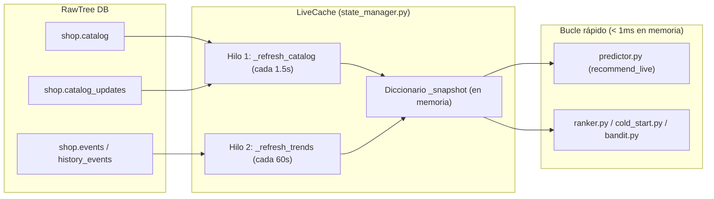

# Funcionamiento de `state_manager.py` y la clase `LiveCache`

## 1. Objetivo general
En el reto de RawTree tenemos un presupuesto estricto de **3 segundos por request**. Si hiciéramos consultas SQL a RawTree (catálogo, stock, precios, tendencias) dentro del bucle de recomendación por cada comprador, superaríamos los 3 segundos y caeríamos en `fallback`.

`state_manager.py` resuelve esto manteniendo **toda la información de la tienda en memoria dentro de diccionarios de Python** y actualizándola en segundo plano mediante dos hilos (`daemon threads`) independientes.

---

## 2. Arquitectura de `LiveCache`



### Ciclo de vida de `LiveCache`
1. **Arranque (`initialize()`):**
   - Descarga `shop.catalog` (5.000 productos) y llena `self.catalog` y `self.prices`.
   - Aplica en orden temporal todos los eventos de `shop.catalog_updates` (`out_of_stock`, `back_in_stock`, `new_product`, `price_change`).
   - Calcula `best_sellers` desde `shop.history_events` y las tendencias iniciales desde `shop.events`.
   - Publica el primer diccionario `self._snapshot`.
2. **Hilo 1 — `_refresh_catalog` (cada `1.5 s`):**
   - Consulta únicamente las filas nuevas de `shop.catalog_updates` (`WHERE ts > _last_update_ts`).
   - Actualiza al instante si un producto se quedó sin stock, volvió a estar disponible, es nuevo o bajó de precio.
3. **Hilo 2 — `_refresh_trends` (cada `60 s`):**
   - Consulta `shop.events` (últimos 60 min) y actualiza las listas de productos en tendencia (global, por categoría, por región y picos de velocidad de 15 min).
4. **Publicación sin bloqueos (`_publish_snapshot()` y `get_snapshot()`):**
   - Cada vez que un hilo actualiza datos, genera un nuevo diccionario con `_build_snapshot()` filtrando automáticamente cualquier producto sin stock o inactivo, y reemplaza `self._snapshot` usando `self._lock`.
   - Cuando `recommender.py` llama a `cache.get_snapshot()`, recibe ese diccionario inmediatamente en memoria sin esperar a la red.

---

## 3. Estructura exacta del diccionario que entrega `get_snapshot()`

`snap = cache.get_snapshot()` devuelve un `dict[str, Any]` con estas claves:

| Clave en `snap` | Tipo | Contenido y uso en el ranking |
|---|---|---|
| `snap["active_products"]` | `frozenset[str]` | IDs de productos activos y con stock (`{"p_001897", ...}`). Usado para filtrar candidatos en `O(1)`. |
| `snap["prices"]` | `dict[str, float]` | `{product_id: price_eur}` con el precio vigente de cada producto. |
| `snap["catalog"]` | `dict[str, dict]` | `{product_id: {...}}` con `category`, `subcategory`, `brand`, `price_eur`, `description`, `is_active`, `in_stock`. |
| `snap["new_products"]` | `frozenset[str]` | IDs añadidos durante el evento (`change == 'new_product'`). Activa la lógica de *cold start*. |
| `snap["price_drops"]` | `dict[str, float]` | `{product_id: descuento}` para productos que bajaron $\ge 5\%$ de precio (ej. `0.15` = 15% de rebaja). |
| `snap["trending_global"]` | `list[str]` | Top productos activos de los últimos 60 min (ponderando `5*purchase + 2*add_to_cart + 1*view`). |
| `snap["top_selling"]` | `list[str]` | Top productos activos más comprados en los últimos 60 min. |
| `snap["top_viewed"]` | `list[str]` | Top productos activos más vistos en los últimos 60 min. |
| `snap["trending_by_category"]` | `dict[str, list[str]]` | `{category: [product_id, ...]}` con el top activo de los últimos 60 min en cada categoría (incluyendo `new_products`). |
| `snap["trending_by_region"]` | `dict[str, list[str]]` | `{region: [product_id, ...]}` con el top 20 activo de los últimos 60 min en cada región. |
| `snap["velocity_spikes"]` | `list[str]` | Productos con pico repentino de tráfico (comparando tasa de última hora contra su **baseline de 60 días** y últimos 15 min vs 3 h previas). |
| `snap["best_sellers"]` | `list[str]` | Ranking histórico de productos activos más comprados en los 60 días previos. |
| `snap["updated_at"]` | `float` | Timestamp UNIX de la última actualización del snapshot. |

---

## 4. Cómo usar `snap` desde `ranker.py`, `cold_start.py` y `bandit.py`

```python
def rank(req: dict, snap: dict, candidates=None) -> list[str]:
    active = snap["active_products"]
    catalog = snap["catalog"]
    prices = snap["prices"]
    by_cat = snap["trending_by_category"]

    # Ejemplo: obtener la categoría y precio del último producto visto en la sesión
    recent = req.get("recent_views", [])
    if recent:
        last_pid = recent[-1]["product_id"]
        info = catalog.get(last_pid, {})
        cat = info.get("category")
        ref_price = prices.get(last_pid, 0.0)
        # Candidatos en tendencia dentro de esa misma categoría
        cat_candidates = by_cat.get(cat, [])
```
